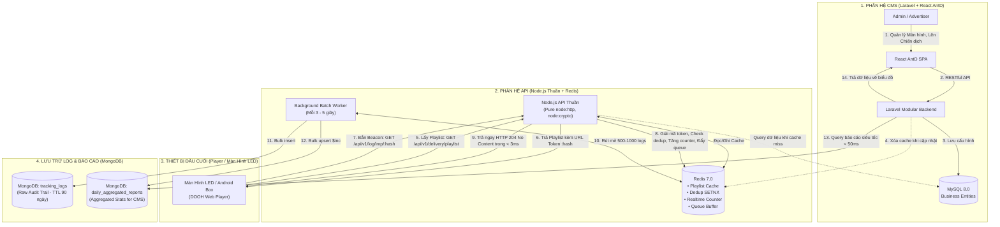
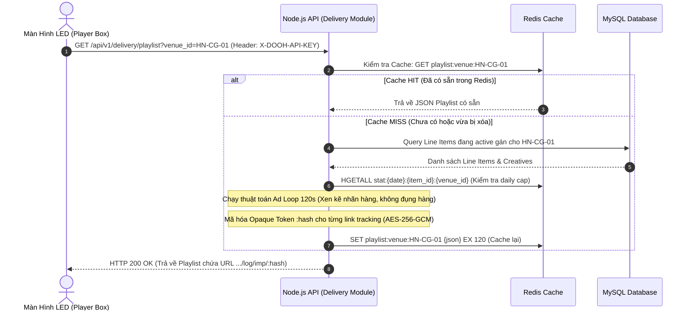
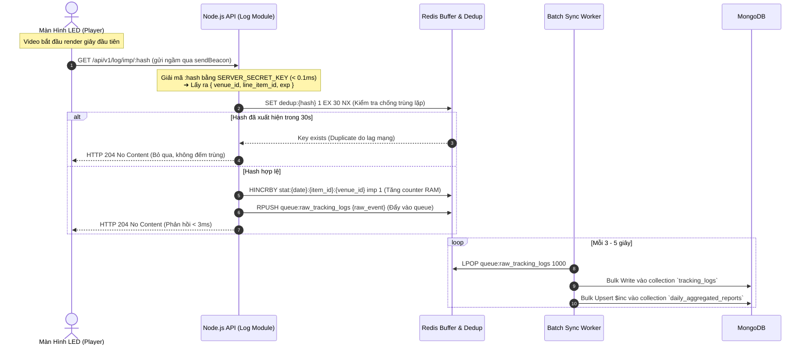
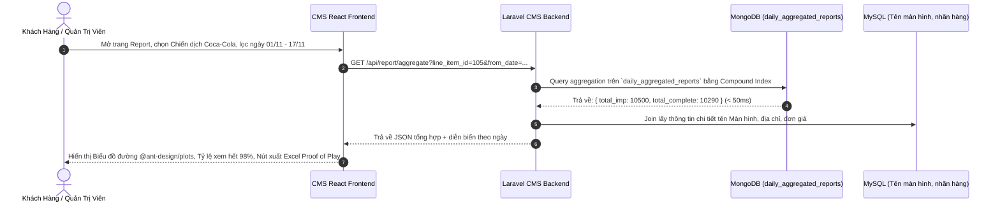
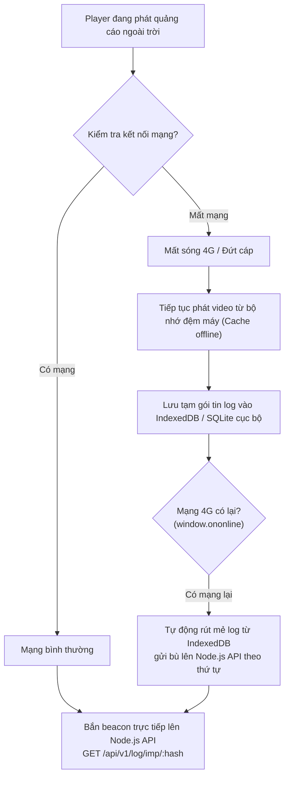

# Sơ Đồ Hoạt Động & Luồng Dữ Liệu Hệ Thống DOOH (System Flow)

Tài liệu chi tiết toàn bộ các luồng hoạt động chính từ giao diện người dùng, phân phối lịch phát, thu nhận tracking tốc độ cao cho đến lưu trữ và nghiệm thu.

---

## 1. Sơ Đồ Hoạt Động Tổng Thể (End-to-End Architecture Flow)



---

## 2. Luồng 1: Thiết Lập Chiến Dịch & Quản Lý Màn Hình (CMS Flow)

```mermaid
sequenceDiagram
    autonumber
    actor Admin as Admin / Nhà Quảng Cáo
    participant UI as CMS React Frontend
    participant API as Laravel CMS Backend
    participant MySQL as MySQL Database
    participant Redis as Redis Cache

    Admin->>UI: 1. Tạo Màn hình (Venue) mới hoặc Chiến dịch (Campaign)
    Admin->>UI: 2. Tạo Line Item (Chọn Venue 1,2,3; ngày chạy; target imp; daily cap)
    Admin->>UI: 3. Tải lên file Video MP4 hoặc Ảnh Banner
    UI->>API: POST /api/delivery/line-items (Gửi thông số & file)
    API->>MySQL: Lưu vào `campaigns`, `line_items`, `creatives`, `line_item_venues`
    API->>Redis: Xóa Cache cũ: DEL playlist:venue:{venue_id}
    API-->>UI: HTTP 201 Created (Kèm link Preview Simulator)
    UI-->>Admin: Hiển thị trạng thái Active & Nút xem mô phỏng
```

---

## 3. Luồng 2: Màn Hình Tải Danh Sách Phát (Playlist Flow)



---

## 4. Luồng 3: Thu Nhận Tracking Beacon Siêu Tốc (Tracking Flow)



---

## 5. Luồng 4: Báo Cáo & Nghiệm Thu Tính Tiền (Reporting Flow)



---

## 6. Luồng 5: Cơ Chế Chịu Lỗi Khi Mất Mạng Ngoài Trời (Offline Resilience Flow)


